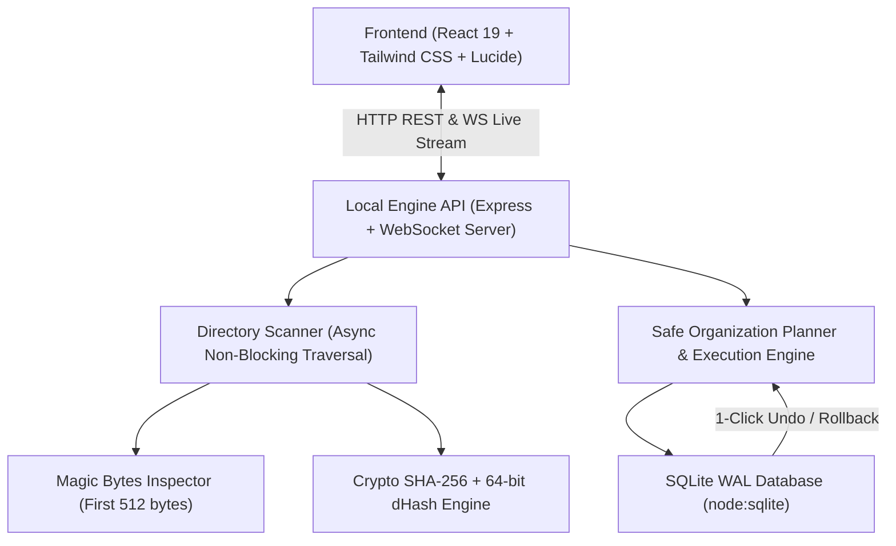

# Universal Smart File Organizer

> **A production-ready, local-first, privacy-focused intelligent file management and organization suite.**
> Built with modern TypeScript/Node.js, high-performance binary magic-byte detection, cryptographic SHA-256 and 64-bit perceptual hashing, native SQLite journaled atomic rollbacks, and an Apple-grade responsive desktop & mobile interface.

---

## 🌟 Key Highlights & Philosophy

- **100% Local & Privacy-Guaranteed**: Zero telemetry, zero cloud dependencies. All hashing, categorization, and metadata indexing occur locally on the user's device.
- **Magic-Byte Signature Intelligence**: Analyzes the first 512 bytes of file headers to identify genuine file types (PNG, JPEG, WebP, PDF, SQLite, ZIP, DOCX, APK, EXE, ELF, Fonts) even when extensions are stripped or misleading.
- **21 Standardized Organization Categories**:
  - 📁 Photos, Videos, Documents, PDFs, Spreadsheets, Presentations, Audio, Music, Software, Applications, APK Files, ZIP & Archives, Programming Files, Code Projects, Database Files, Design Files, Fonts, E-books, Backups, System Files, Other Files.
- **Multi-Stage Duplicate & Visual Similarity Engine**:
  - Size pre-filtering &rarr; 32KB Head/Tail partial hash elimination &rarr; Streaming SHA-256 cryptographic verification.
  - 64-bit perceptual difference hashing (`dHash`) to identify visually similar photos even when resized or recompressed.
  - **Zero Automatic Deletions**: Displays side-by-side previews, recommends the best original copy to retain (based on resolution, timestamp, and clean location), and requires explicit user consent.
  - Safe quarantine option via `.desktopor_trash`.
- **Safe Transactional Organization & 1-Click Undo**:
  - Pre-flight dry-run plan with conflict detection (Smart Rename with `(1)`, Skip, or Overwrite).
  - Atomic operation logging in SQLite WAL mode.
  - 1-Click Rollback / Undo that restores moved or copied files back to their exact original locations and prunes newly created empty folders.
- **Protected System Shields**: Hard-coded safety shields preventing accidental touches or movements of Windows (`C:\Windows`, `Program Files`, `System32`), macOS (`/System`, `/Applications`), or Linux system directories.

---

## 🏗️ Architecture Overview



---

## 📱 Cross-Platform Deployment Strategy

The application is engineered with a decoupled local-first core:

1. **Windows 10 / 11, macOS, Linux (Desktop)**:
   - Run directly as a local web/desktop engine (`npm start`) or wrap via Electron / Tauri for native window management and tray integration.
2. **Android & iOS (Mobile)**:
   - Shared client frontend can be bundled using **Capacitor** (`@capacitor/core`, `@capacitor/filesystem`) with native scoped storage permissions:
     - Android: Uses Android Storage Access Framework (`SAF`) and `MANAGE_EXTERNAL_STORAGE` where permitted.
     - iOS: Runs within the iOS app sandbox, utilizing the Document Picker (`UIDocumentPickerViewController`) for user-selected folders.

---

## 🚀 Getting Started

### Prerequisites
- Node.js v20+ (Node v24 recommended for built-in `node:sqlite`).

### Installation
```bash
# Clone and enter the repository
cd desktopor

# Install dependencies
npm install

# Build the client production bundle
npm run build:client
```

### Running the Application

#### 1. Launch the Full Desktop / Local Web UI
```bash
npm start
```
Open **`http://localhost:3001`** in your browser or desktop container.

#### 2. Development Mode (Hot-Reloading)
```bash
# Terminal 1: Start backend server
npm run dev:server

# Terminal 2: Start Vite client dev server
npm run dev:client
```

#### 3. CLI Mode (Headless / Terminal Operations)
```bash
# Scan a folder
node bin/organizer-cli.js scan "D:\Downloads"

# Safely organize a folder (Copy or Move)
node bin/organizer-cli.js organize "D:\Downloads" --move

# Undo an operation
node bin/organizer-cli.js undo <OPERATION_ID>
```

#### 4. Run Automated Test Suite
```bash
npm test
```
Executes all 8 system integrity tests covering magic-byte identification, duplicate detection, organization planning, collision handling, and atomic undo restore.

---

## 🛡️ Privacy & Security Assurance

- **Zero Cloud Traffic**: Works completely disconnected from the Internet.
- **Read-Only Inspection**: File contents are never altered or edited.
- **System Shields**: Strictly prohibits operations inside system folders.
- **Quarantine Recovery**: Duplicate deletion defaults to local recovery trash (`.desktopor_trash`).
