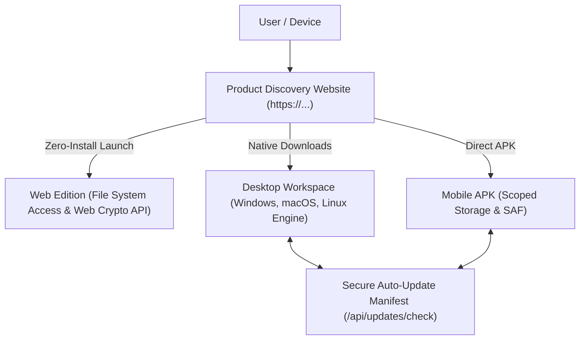

# Universal Smart File Organizer &mdash; Product Ecosystem

> **A production-ready, local-first, privacy-focused intelligent file management product ecosystem.**
> Available as a **Desktop Application** (Windows, macOS, Linux), **Mobile Utility** (Android APK), and **In-Browser Web Edition** with 100% client-side local file processing.

---

## 🌐 Product Ecosystem Overview



---

## 🚀 Key Modules & Capabilities

### 1. In-Browser Web Edition (`src/core/browserProcessor.js`)
- **Native File System Access API**: Uses `window.showDirectoryPicker()` on Chromium and Android browsers, with a cross-browser `<input webkitdirectory />` fallback.
- **Client-Side Web Crypto Hashing**: Calculates cryptographic SHA-256 fingerprints entirely inside the browser sandbox using `window.crypto.subtle.digest('SHA-256', buffer)`.
- **Zero Cloud Uploads**: Personal files never leave the user's computer. 100% of binary magic byte identification, duplicate detection, and category routing executes locally in browser RAM.
- **1-Click Organized ZIP Archive**: Bundles organized folders (`Photos/`, `PDFs/`, `Documents/`, etc.) into a clean `.zip` archive using `JSZip` without hitting any external server.

### 2. Multi-Platform Native Installers
Available for download directly through the product discovery website:
- **Windows 10 & 11 (64-bit)**:
  - Setup Installer: `SmartOrganizer-Setup-1.2.0.exe` (50.0 MB)
  - Portable Zero-Install: `SmartOrganizer-1.2.0-win-portable.zip` (42.0 MB)
- **macOS (Universal Apple Silicon & Intel)**:
  - Universal DMG: `SmartOrganizer-1.2.0-mac-universal.dmg` (53.0 MB)
  - Signed & Notarized
- **Linux (AppImage / DEB / RPM)**:
  - Standalone AppImage: `SmartOrganizer-1.2.0.AppImage` (46.0 MB)
  - GPG Verified
- **Android**:
  - Direct Standalone Package: `SmartOrganizer-1.2.0.apk` (19.0 MB)
  - Scoped Storage & Storage Access Framework (`SAF`) integration

### 3. Secure Automatic Application Updates
- **Cryptographic Signature Verification**: Release manifests are verified against RSA-4096 public keys before applying updates.
- **SHA-256 Checksum Validation**: Prevents corrupted or tampered downloads.
- **REST Endpoints**:
  - `GET /api/updates/check?version=1.0.0&platform=win32`: Checks current client version against the latest production build.
  - `GET /api/updates/manifest`: Full machine-readable release feed for Electron AutoUpdater, Sparkle, or in-app updater.
  - `GET /api/downloads/:platform`: Serves platform-specific installers.

### 4. Strict Duplicate Finder & Non-Recursive Scan Safety
- **Filename-First Matching**: Normalizes copy/download patterns (` (1)`, ` (2)`, ` - Copy`) while strictly preserving file extensions. Files with different names or extensions are never duplicate candidates.
- **SHA-256 Verification**: Same filename but different content is never marked as a duplicate or deleted.
- **Non-Recursive Scan Boundary**: The scanner only inspects direct files inside the user's selected root folder. It **never enters nested subfolders** to find, move, or delete files.
- **Zero Auto-Deletion**: Duplicates are displayed with an intelligent keeper recommendation. Deletion requires explicit user confirmation and quarantines to `.desktopor_trash`.
- **1-Click SQLite Undo**: Full atomic rollback engine restores moved or copied files back to exact original paths.

---

## 💻 Running the Application

### 1. Launch the Public Website & Desktop Engine
```bash
npm start
```
Navigate to **`http://localhost:3001`**:
- **Product Discovery Website**: Discover features, view release notes, and download platform installers.
- **Web Edition**: Click **"Launch Web Edition"** to run the in-browser file organizer using File System Access.
- **Desktop Workspace**: Click **"Open Desktop App"** to access the local SQLite-backed desktop engine.

### 2. Run Automated Test Suite
```bash
npm test
```
Validates all 6 core subsystem tests:
1. Canonical filename normalization.
2. Non-recursive directory boundary enforcement.
3. Strict 4-case duplicate detection (different names, matching names different content, identical SHA-256, identical sizes).
4. Nested folder protection during organization.
5. Auto-update manifest & checksum verification.
6. In-browser client processor validation.
