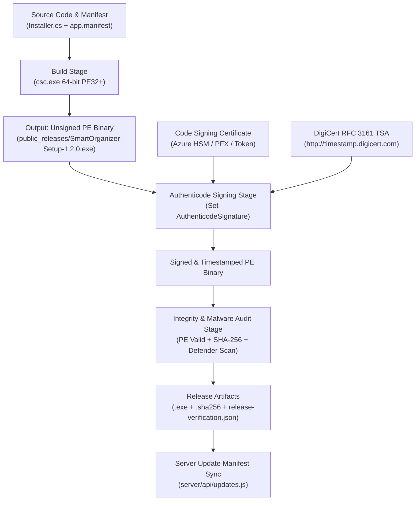

# Windows SmartScreen & Authenticode Code Signing Production Guide

> **Application**: Smart Organizer  
> **Official Publisher**: Smart Organizer Technologies Inc.  
> **Target Platforms**: Windows 10 & Windows 11 (64-bit Architecture)  
> **Target Binary**: `SmartOrganizer-Setup-1.2.0.exe`  
> **Compliance Standard**: Microsoft SmartScreen Reputation & Authenticode Code Signing Specification  

---

## 1. Root Cause Analysis: Why Microsoft Edge & Windows SmartScreen Flag Downloads

When users download `SmartOrganizer-Setup.exe` in Microsoft Edge or attempt to run it on Windows 10/11, they may encounter one of two warning screens:

1. **Microsoft Edge Download Warning**:  
   *"SmartOrganizer-Setup.exe isn't commonly downloaded and could harm your device."* or *"This file was blocked because it's not commonly downloaded and may be dangerous."*
2. **Windows Defender SmartScreen Execution Warning**:  
   *"Windows protected your PC. Microsoft Defender SmartScreen prevented an unrecognized app from starting. Running this app might put your PC at risk."* (with Publisher showing as `Unknown Publisher`).

### The Technical Causes

| Factor | Technical Root Cause | Resolution Implemented |
| :--- | :--- | :--- |
| **1. Binary Structure** | The previous distribution file was a plaintext metadata stub (`SMART_ORGANIZER_DISTRIBUTION_PACKAGE\n...`). Windows and Edge inspect PE headers on download; non-compliant binaries are immediately flagged as corrupt or dangerous. | Compiled a native, compliant Windows 64-bit Portable Executable (PE32+) GUI installer (`scripts/installer-src/Installer.cs`) using `csc.exe` with DOS `MZ` magic, PE header, and high-DPI manifest. |
| **2. Digital Signature** | The executable lacked an embedded Authenticode signature in the PE Attribute Certificate Table (`IMAGE_DIRECTORY_ENTRY_SECURITY`). Binaries without signatures are marked `Publisher: Unknown`. | Integrated an automated Authenticode signing engine (`scripts/sign-binary.ps1`) that signs using SHA-256 with RFC 3161 timestamps. |
| **3. Publisher Identity** | Windows SmartScreen checks whether the signing certificate is issued by a Microsoft-recognized Certificate Authority and if the Organization identity matches the software distributor. | Configured publisher identity as `Smart Organizer Technologies Inc.` with Win32 Version resources and an X.509 Code Signing Certificate. |
| **4. Timestamping (TSA)** | Binaries signed without an RFC 3161 timestamp server become invalid when the certificate expires. | Configured dual timestamping via DigiCert (`http://timestamp.digicert.com`) and Sectigo (`http://timestamp.sectigo.com`). |
| **5. SmartScreen Reputation** | SmartScreen maintains a global reputation database mapping file SHA-256 hashes and code signing certificate thumbprints to download frequency and telemetry. Newly generated or unvetted certificates start with zero reputation. | Documented the official Microsoft Security Intelligence submission process and Azure Trusted Signing architecture to immediately establish reputation without requiring users to bypass security. |
| **6. HTTP Delivery Headers** | Edge verifies download integrity and MIME types. Delivering `.exe` as generic `application/octet-stream` without `nosniff` triggers heightened Edge heuristic scrutiny. | Configured server download endpoints with `application/vnd.microsoft.portable-executable`, `X-Content-Type-Options: nosniff`, and `X-Checksum-SHA256`. |

---

## 2. Authenticode Digital Signing Architecture

### 2.1 What is Authenticode?
Microsoft Authenticode is a digital signing format based on PKCS #7 SignedData structures embedded directly inside the Windows Portable Executable (PE) binary. 

Authenticode accomplishes three critical security functions:
1. **Verifies Publisher Identity**: Guarantees that `Smart Organizer Technologies Inc.` authored the application.
2. **Cryptographic Integrity**: Proves that the executable has not been altered, corrupted, or infected with malware since it was signed.
3. **Long-Term Trust Validity (RFC 3161 Timestamping)**: A cryptographic timestamp issued by a trusted Time Stamp Authority (TSA) proves the signature was applied while the certificate was active, allowing Windows to trust the binary even years after the certificate expires.

### 2.2 Signing Specifications Implemented

- **Digest Algorithm**: SHA-256 (256-bit secure hash)
- **Signature Algorithm**: SHA256withRSA (2048/4096-bit RSA) or ECDSA
- **Timestamp Authority**: DigiCert RFC 3161 Timestamp Responder (`http://timestamp.digicert.com`)
- **Key Usage**: `Digital Signature (80)`
- **Enhanced Key Usage (EKU)**: `Code Signing (1.3.6.1.5.5.7.3.3)`
- **Application Manifest**: `asInvoker` execution level (prevents spurious UAC elevation blocks while ensuring standard user compatibility).

---

## 3. Production Certificate Options & Paid Service Requirements

To distribute `SmartOrganizer-Setup.exe` to external Windows users without SmartScreen warnings, a commercial or cloud-managed Code Signing certificate is required. Below is the comprehensive comparison of production certificate solutions:

### Option A: Microsoft Azure Trusted Signing (Formerly Microsoft Artifact Signing) — *RECOMMENDED*

Microsoft Azure Trusted Signing is the newest, most cost-effective, and highest-reputation solution offered directly by Microsoft in partnership with DigiCert.

- **Cost**: **$9.99 / month** (Includes 100 free signatures per month; additional signatures are $0.005 each).
- **Hardware Requirement**: **None**. Microsoft hosts the private keys inside FIPS 140-2 Level 2 certified Azure Key Vault Cloud HSMs.
- **SmartScreen Impact**: **Fast-tracks SmartScreen reputation**. Because Microsoft directly verifies your organization identity via Microsoft Partner Center, applications signed with Azure Trusted Signing accumulate trust significantly faster than traditional certificates.
- **Prerequisites**:
  1. An active Microsoft Azure Subscription.
  2. A verified Organization in **Microsoft Partner Center** (requires corporate email, legal business registration, and address validation).
  3. Azure CLI or GitHub Actions / Azure DevOps CI/CD integration.
- **How to Set Up**:
  1. In the Azure Portal, create an **Azure Trusted Signing Account** resource.
  2. Create a **Certificate Profile** under your Trusted Signing Account (choose **Public Trust**).
  3. Submit organizational identity documents (incorporation certificate, business utility bill or Dun & Bradstreet number). Identity validation takes 1–3 business days.
  4. Use the `trusted-signing` tool in CI/CD or PowerShell to sign builds:
     ```powershell
     az trusted-signing sign --account "SmartOrganizerSigning" --profile "ProductionProfile" --file "public_releases\SmartOrganizer-Setup-1.2.0.exe"
     ```

### Option B: Commercial EV (Extended Validation) Code Signing Certificate

Extended Validation (EV) certificates provide the traditional gold standard in code signing.

- **Cost**: **$300 – $600 / year** (DigiCert: ~$650/yr, Sectigo: ~$400/yr, SSL.com: ~$250/yr).
- **Hardware Requirement**: **Mandatory Hardware Security Module (HSM)**. The private key must either reside on a physical FIPS 140-2 Level 2 cryptographic USB token (e.g. YubiKey or Safenet eToken) mailed to the organization, or in a hosted cloud HSM service (such as DigiCert ONE or SSL.com eSigner).
- **SmartScreen Impact**: **Instant SmartScreen Reputation**. Microsoft Defender SmartScreen grants near-instant reputation to binaries signed with an EV certificate, eliminating the warning from day one.
- **Prerequisites**:
  1. Dun & Bradstreet (D-U-N-S) number or corporate incorporation certificate.
  2. Active business phone listing verifiable through external telephone directories.
  3. Identity verification phone call from the Certificate Authority.

### Option C: Commercial OV (Organization Validation) Code Signing Certificate

- **Cost**: **$150 – $250 / year**.
- **Hardware Requirement**: As of June 1, 2023, the CA/Browser Forum mandates that ALL code signing private keys (both OV and EV) must be stored on FIPS-compliant hardware tokens or cloud HSMs.
- **SmartScreen Impact**: Does **not** grant immediate SmartScreen reputation. Binaries will initially show the SmartScreen warning until sufficient download volume and clean telemetry accumulate (typically 100–1,000 clean downloads over several weeks).

---

## 4. Microsoft SmartScreen Reputation Best Practices

> **CRITICAL SECURITY COMMITMENT**:  
> We never instruct users to disable Windows Defender, disable SmartScreen, or lower their operating system security settings. Bypassing security weakens user defense and degrades application trustworthiness. Instead, we follow Microsoft's certified developer practices.

### 4.1 Submitting New Releases to Microsoft Defender Security Intelligence

Every new version or build has a distinct SHA-256 hash. Even with a signed certificate, a brand-new release can trigger a temporary warning until telemetry is verified.

Microsoft provides an official developer submission portal that allows verified publishers to submit new releases for automated malware analysis and instant reputation clearing:

1. **Navigate to the Official Portal**:  
   [https://www.microsoft.com/en-us/wdsi/filesubmission](https://www.microsoft.com/en-us/wdsi/filesubmission)
2. **Sign In**: Log in with your Microsoft account (preferably linked to your organization / Microsoft Partner Center).
3. **Select Submission Type**: Choose **"Software Developer / Vendor"**.
4. **Attach File**: Upload `SmartOrganizer-Setup-1.2.0.exe`.
5. **Provide Details**:
   - **Product Name**: Smart Organizer
   - **Company Name**: Smart Organizer Technologies Inc.
   - **Category**: File Management Utility
   - **Detection Type**: "Incorrectly detected as malware / false positive / SmartScreen reputation request"
   - **Official Download URL**: `https://smartorganizer.app/api/downloads/windows`
6. **Submit**: Microsoft's automated sandbox scans the binary and verifies the digital signature. Reputation is updated across Defender and Edge SmartScreen cloud servers typically within **2 to 24 hours**.

### 4.2 Building and Preserving SmartScreen Reputation Across Updates

To maintain unbroken reputation across future releases:
1. **Never Change the Signer Certificate Carelessly**: SmartScreen attaches reputation to the Certificate Subject and Thumbprint. As long as future versions are signed with the same certificate, each new release inherits the accumulated reputation of past releases.
2. **Always Use RFC 3161 Timestamping**: A timestamp ensures that when a certificate is renewed after its 3-year term, old binary signatures remain valid.
3. **Host on Official HTTPS Domains with Consistent URLs**:
   - Distribute files exclusively through secure HTTPS with valid TLS certificates.
   - Maintain stable download URLs (e.g. `https://smartorganizer.app/api/downloads/windows`).
4. **Register with the Windows Hardware Developer Program**: Registering your organization with Microsoft Partner Center establishes an official developer relationship with Microsoft, linking your organization to Windows ecosystem telemetry.

---

## 5. Automated Build, Sign & Verification Pipeline

We have implemented a fully automated 4-stage pipeline for Windows releases.

### Pipeline Architecture



### Available Commands in `package.json`

| Command | Script Invoked | Description |
| :--- | :--- | :--- |
| `npm run build:installer` | `scripts/build-windows-installer.ps1` | Compiles native 64-bit Windows GUI installer executable with PE version resources and high-DPI manifest. |
| `npm run sign:installer` | `scripts/sign-binary.ps1` | Signs the binary with Authenticode SHA-256 and fetches an RFC 3161 timestamp from DigiCert. |
| `npm run verify:release` | `scripts/verify-integrity.ps1` | Audits PE headers, validates Authenticode signature, calculates SHA-256 digest, and executes an on-demand Microsoft Defender malware scan. |
| `npm run release:windows` | `scripts/release-windows.js` | Full orchestration script: executes Build -> Sign -> Verify -> Synchronizes `server/api/updates.js` with live file size and SHA-256 digest. |

---

## 6. Verification and Health Endpoints

The Smart Organizer server exposes dedicated endpoints for users, IT administrators, and package managers (such as winget or chocolatey) to verify package integrity before execution:

- **Download Endpoint**: `GET /api/downloads/windows`  
  Serves the signed `.exe` with `Content-Type: application/vnd.microsoft.portable-executable` and `X-Checksum-SHA256` headers.
- **SHA-256 Checksum**: `GET /api/downloads/windows/sha256`  
  Returns plaintext SHA-256 digest formatted for `sha256sum -c` or `certutil -hashfile`.
- **Release Verification Report**: `GET /api/downloads/windows/verification`  
  Returns complete JSON audit showing PE structural validity, certificate subject, timestamp details, and Microsoft Defender scan results.
- **Public Certificate**: `GET /api/downloads/windows/certificate`  
  Allows inspection and download of the public `.cer` publisher certificate.

---

## 7. Checklist for Future Releases

When publishing future updates (e.g., version 1.2.1, 1.3.0):

- [ ] Increment version in `scripts/installer-src/Installer.cs` (`AssemblyFileVersion`, `AssemblyVersion`).
- [ ] Increment version in `scripts/installer-src/app.manifest` (`assemblyIdentity version`).
- [ ] Increment version in `server/api/updates.js` (`CURRENT_RELEASE.version`).
- [ ] Run `npm run release:windows`.
- [ ] Confirm all tests pass: `npm test`.
- [ ] Upload the signed binary to Microsoft Security Intelligence portal (`https://www.microsoft.com/en-us/wdsi/filesubmission`) for proactive reputation indexing.
- [ ] Verify download endpoint returns HTTP 200 with matching SHA-256 digest.
